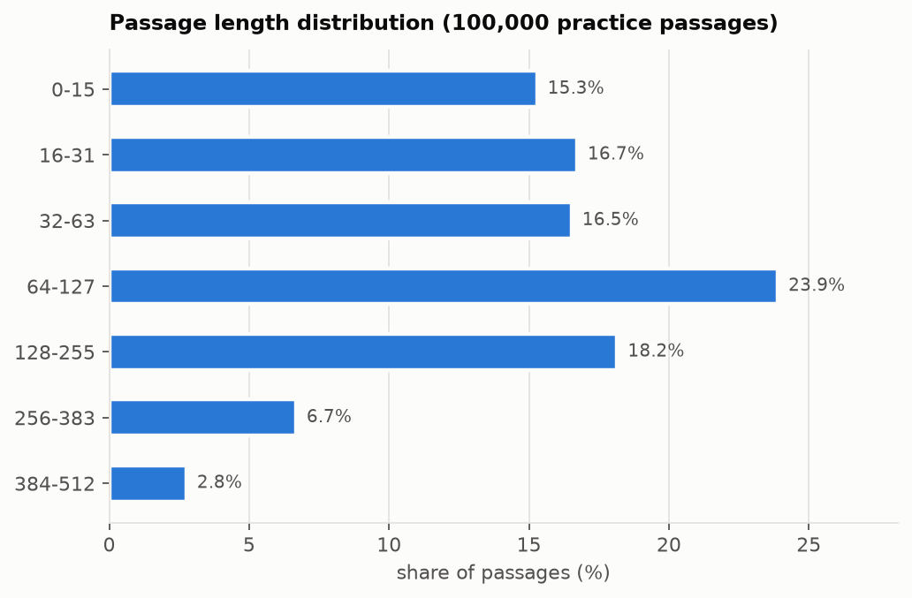
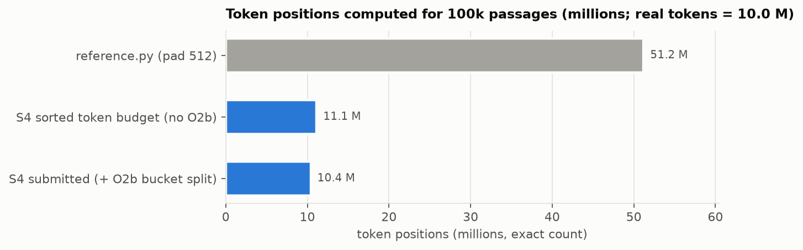
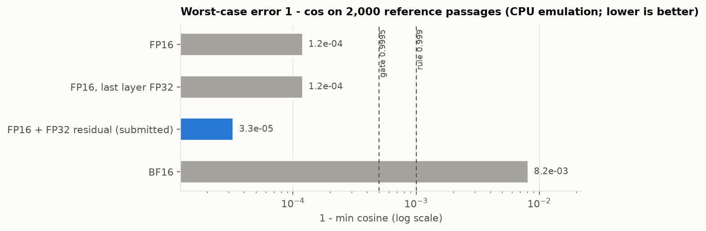
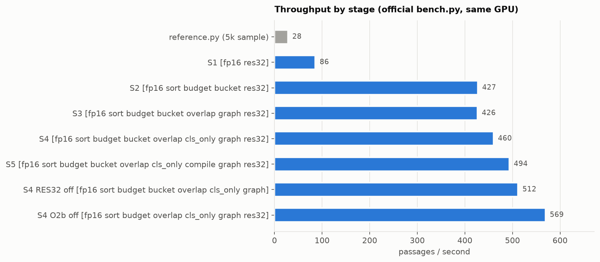
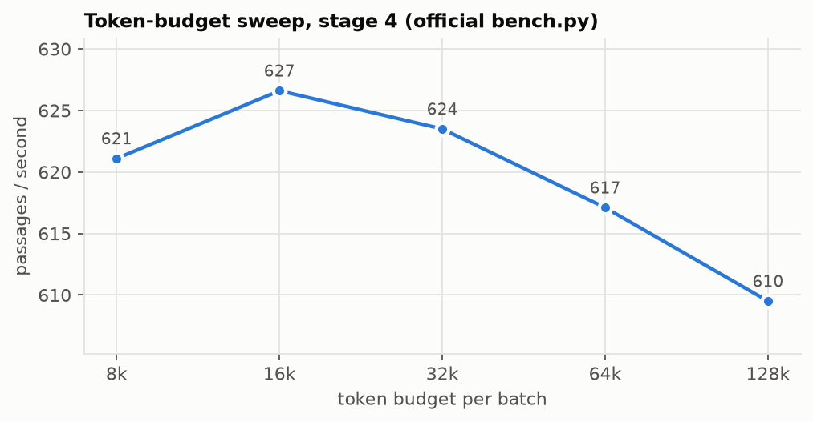
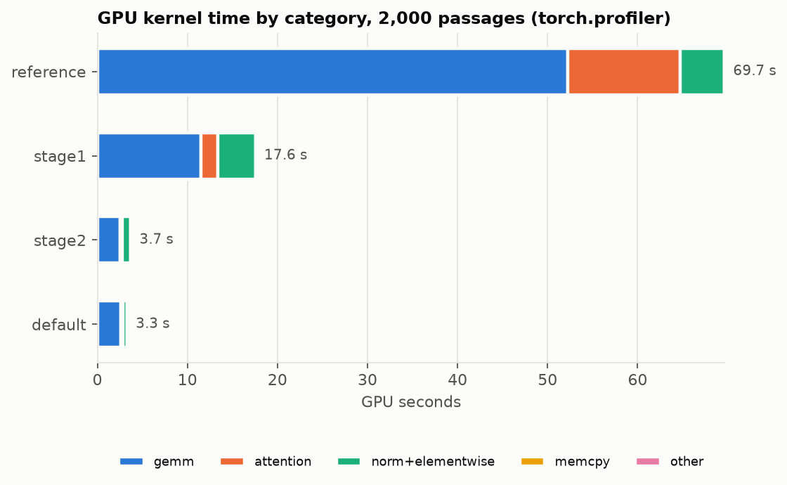

# PS-09: High-Throughput GPU Inference Optimisation for BGE Text Encoders

Kernel Optimisation for Encoders · Theme: Pipeline Building · Submission file: `team.py`

> **How to read the numbers.** Every figure is labelled as one of: **measured** (produced by a script in this repository;
> file named), **CPU emulation** (measured on a CPU, emulating GPU numerics), **reported** (from the teammate's tracker,
> not reproduced here), or **estimate** (calculated, not measured). Sections fed by result files are regenerated by
> `scripts/make_report.py`; anything not yet measured on the GPU is shown as PENDING.

## 1. Executive summary

The reference encoder (`reference.py`) runs BAAI/bge-base-en-v1.5 in FP32 and pads every input to 512 tokens. On the
practice set the average passage has 100 tokens, so **80.4% of the reference's work is padding** (measured, exact).
Our `team.py` keeps the same weights, the same 12-layer architecture and the same maths, and changes only *how* the
model runs:

1. **Length-aware scheduling** (sort by length, token-budget batches, split at length buckets): token positions
   computed drop from 51.2 M to 10.4 M for 100k passages; with the CLS-only last layer the analytical work is
   **5.62x lower** than the reference (measured, exact count).
2. **FP16 Tensor-Core GEMMs**, fused QKV projection and PyTorch's fused SDPA attention.
3. **Overlapped host pipeline** (tokenisation in a background thread, pinned memory, asynchronous copies, one sync).
4. **CLS-only last layer**: the last layer computes keys/values for all tokens but everything else for the CLS row only.
5. **CUDA Graphs for live queries**: one graph replay per query instead of hundreds of kernel launches.
6. **Short inputs in FP32** (P2): inputs of at most 32 tokens run through an FP32 copy of the same weights, offline and
   live; everything longer runs in FP16.

Accuracy is protected by a **precision gate** (minimum cosine ≥ 0.9995 internally, 0.999 is the rule) and by a check
of **all 100,000 practice passages** against our FP32 path, not only the 2,000 the official harness checks. That full
check found what the 2,000-passage check could not: with FP16 everywhere, 2 of 100,000 passages fell below 0.999
(worst 0.99440), and even with an FP32 residual stream 1 did (0.99779). Every FP16 result below 0.9999 was a passage
of at most 23 tokens; above 32 tokens plain FP16 is ≥ 0.99999. Short passages are 33% of the passages but only 5.5% of
the tokens, so running them in FP32 removes the risk at a small cost (Section 11).

**Result on the RTX 3050 6GB Laptop GPU (measured, official `bench.py`, all 100,000 practice passages):
604.9 passages/s against the reference's 28.4, a 21.3x speed-up**, 0 tolerance violations, minimum cosine 0.999992
over all 100,000 passages against FP32 (0.999999 on the official 2,000), live p50 4.4 ms / p99 8.2 ms, peak GPU memory
1.6 GB. Sections 13-18 give the ablation, budget sweep, latency, profiles and accuracy evidence.

## 2. Problem statement

A university library needs embeddings for millions of passages on one modest GPU. The model must stay
BAAI/bge-base-en-v1.5 (no smaller model, no INT8, no weight or architecture changes). Each output must have cosine
≥ 0.999 to the FP32 reference on **every** input; a single violation scores zero. Scoring: batch throughput speed-up
50% (log scale, full marks at 40x), profiler report 25%, live-query p50/p99 15%, demo 10%.

The official harness (`bench.py`) calls `setup()` once (not timed), then `encode(all_passages)` once (timed end to end,
including tokenisation), then replays a query trace in real time with `encode([query])`, one query at a time, FIFO,
so latency includes waiting behind earlier queries of a burst.

## 3. Baseline architecture

`reference.py`: Hugging Face `AutoModel` in FP32, tokenizer with `padding="max_length", max_length=512`, batch 32, CLS
token of the last hidden state, L2-normalised, `.cpu()` after every batch.

## 4. Inefficiencies in the baseline

| Problem | Why it costs time | Evidence |
|---|---|---|
| Padding to 512 | dense layers cost ∝ padded length, attention ∝ length² | 80.4% padding (measured) |
| FP32 arithmetic | no FP16 Tensor Cores; twice the bytes moved | architecture (estimate) |
| Pooler and full last layer | only the CLS row of the last layer is used | model structure |
| Per-batch `.cpu()` sync | GPU idles while the CPU tokenises the next batch | profiler: 136 device idle gaps > 100 µs per 2,000 passages (reference) vs 7 (ours) |
| Single queries | ~200 small kernels each, launch-bound | FP16 service time 2.49 ms eager vs 1.76 ms with a CUDA Graph (measured) |

## 5. Model and hardware

BERT-base: 12 layers, hidden 768, 12 heads, FFN 3072, ~109.5 M parameters, `layer_norm_eps = 1e-12`, absolute
positions, CLS pooling, L2 normalisation. Development GPU: NVIDIA GeForce RTX 3050 Laptop GPU, 6 GB (Ampere, compute
capability 8.6, FP16 Tensor Cores). Development laptop for code and CPU validation: Windows 11, Intel i7-13620H, no
NVIDIA GPU. `team.py` detects the GPU at run time and assumes nothing about its model. The measured hardware and
software versions of every GPU run are in Section 13 (`results_gpu/hardware/`).

## 6. Dataset characteristics

<!-- AUTO:workload -->
Measured with the model's tokenizer on all 100,000 practice passages (exact counts, `scripts/workload_stats.py`).

- Tokens per passage: mean **100.2**, median 67, p10 11, p90 249, p99 459, max 502; 0 reach the 512 limit.
- Padding in the reference (every input padded to 512): **80.4%** of all token positions.
- Queries: 1500 over 242 s, mean 11.9 tokens, max 25; 233 arrivals come < 10 ms after the previous one (bursts).

| Plan | Batches | Token positions | Padding | GFLOPs (analytical) | Work reduction vs reference |
|---|---|---|---|---|---|
| reference.py | 3,125 | 51,200,000 | 80.4% | 9,663,676 | 1.00x |
| S2 | 190 | 10,376,288 | 3.4% | 1,840,448 | 5.25x |
| S4 | 379 | 10,409,528 | 3.7% | 1,718,717 | 5.62x |

Length-bucket split (O2b) at the 65,536-token budget: padding 10.0% -> 3.7%, work reduction 5.25x -> 5.62x.




<!-- /AUTO:workload -->

## 7. Objectives

1. Never violate the tolerance (internal gate 0.9995 on the official references, and a full 100k check).
2. Maximise offline throughput (passages/s on 100k passages, end to end).
3. Minimise live p50/p99 under bursts.
4. Collect before/after profiler evidence for each claim.

## 8. Proposed architecture

```
setup()  (not timed)  load weights -> FP16 copy + FP32 copy (short inputs) -> warm up at the real batch shapes
                      (largest first; halve the token budget if the GPU is too small) -> capture CUDA Graphs (32/64/128)

encode(texts)
 ├─ 1 text  -> tokenise -> copy into the static buffers of the smallest bucket -> graph.replay() -> [1,768]
 │            (the 32-token graph is captured on the FP32 copy; 64/128 on FP16)
 └─ N texts -> producer thread: tokenise 16k-text chunks (Rust tokenizer, no padding)
                 -> sort by length -> token-budget batches split at multiple-of-8 length buckets -> pinned tensors
             -> consumer (main thread): async H2D copy -> 12-layer encoder (fused QKV, SDPA, CLS-only last layer):
                    FP16 for batches of inputs > 32 tokens, FP32 for batches of inputs <= 32 tokens (never mixed)
                 -> CLS -> FP32 L2-normalise -> scatter into a preallocated [N,768] GPU buffer in input order
             -> one device-to-host copy at the end
```

## 9. Optimisation methodology

| ID | Optimisation | Bottleneck targeted | Switch | Stage |
|---|---|---|---|---|
| O1 | FP16 Tensor Cores, fused QKV GEMM, PyTorch SDPA (flash / memory-efficient kernels), no pooler | FP32 GEMMs, unfused attention | `PS09_FP16` | S1+ |
| O2 | Sort by token length, token-budget batches, pad to a multiple of 8 | padding (80.4%) | `PS09_SORT`, `PS09_BUDGET` | S2+ |
| O2b | End a batch where the padded length drops to a lower multiple of 8 (after ≥ 25% of the budget) | residual padding inside large batches | `PS09_BUCKET` | S2+ |
| O3 | Background tokenisation, pinned memory, async copies, single final sync | host stalls | `PS09_OVERLAP` | S3+ |
| O5 | CLS-only last layer | 11/12 of last-layer work unused | `PS09_CLS_ONLY` | S4+ |
| O7 | CUDA Graph per live bucket (32/64/128 tokens) | kernel-launch overhead for single queries | `PS09_GRAPH` | S3+ |
| O4 | `torch.compile` of the encoder | element-wise kernel fusion | `PS09_COMPILE` | S5 |
| P1 | FP32 residual stream + LayerNorm (GEMMs stay FP16) | FP16 rounding of the residual stream | `PS09_RES32` | off (superseded by P2) |
| P2 | Inputs of ≤ 32 tokens in FP32 (separate batches and the 32-token live graph) | FP16 error on short inputs | `PS09_SHORT_FP32` (cut-off, 0 = off) | default 32 |

Stages are cumulative presets (`PS09_STAGE=0..5`); each flag can be overridden alone for ablations. The submitted
defaults are constants at the top of `team.py`; the organisers do not need to set any variable.

Rejected: padding-free variable-length attention (O6) - residual padding is only ~4% after O2/O2b, not worth the
complexity; BF16 - fails the internal gate (Section 11); FP16 accumulation inside GEMMs - expected to break accuracy
(measured on the GPU in `validate_fp16_accum`).

## 10. Mathematical correctness

- **Same weights, same graph.** `team.Encoder` reads the checkpoint's tensors and applies exactly BERT's operations:
  word + position + token-type(0) embeddings → LayerNorm → 12 × [self-attention → output projection + residual →
  LayerNorm → GELU (erf) FFN + residual → LayerNorm] → CLS → L2 normalise.
- **Fused QKV** concatenates the Q, K and V weight matrices row-wise; `linear(x, [Wq;Wk;Wv])` is exactly
  `[linear(x,Wq), linear(x,Wk), linear(x,Wv)]`.
- **Dynamic padding is exact**: padded keys get an additive mask of the dtype's minimum (as in Hugging Face), positions
  start at 0 for every row (right padding), so the CLS output does not depend on how much padding a row has.
- **CLS-only last layer is exact**: in the last layer the CLS output depends on the keys and values of *all* tokens
  (kept) but only on the CLS query, and the output projection, FFN and LayerNorms act row-wise, so the other rows are
  never needed.
- **Ordering**: every batch carries its original indices; outputs are scattered into place on the GPU.
- **Truncation**: the Rust tokenizer truncates at 512 tokens *including* [CLS]/[SEP], like the reference call.

<!-- AUTO:cpu_tests -->
`tests/test_correctness.py` on CPU (29 edge cases, torch 2.15.0+cpu): **ALL PASS**.

| Stage | Flags | Batch min cos | Single-call min cos |
|---|---|---|---|
| 0 |  | 1.0000000 | 1.0000000 |
| 2 | fp16 sort budget bucket | 1.0000000 | 1.0000000 |
| 4 | fp16 sort budget bucket overlap cls_only graph | 1.0000000 | 1.0000000 |
<!-- /AUTO:cpu_tests -->

## 11. Precision analysis

<!-- AUTO:precision -->
CPU emulation of GPU FP16 numerics against the official FP32 reference (2,000 passages, 1,500 queries; `scripts/precision_study.py`). Label: **measured, CPU emulation**.

| Variant | Passages min cos | p0.1 | Mean | < 0.9995 | Queries min cos | Worst passage (tokens) |
|---|---|---|---|---|---|---|
| fp32 | 1.000000 | 1.000000 | 1.0000000 | 0 | 1.000000 | #1170 (15) |
| fp16 | 0.999879 | 0.999930 | 0.9999994 | 0 | 0.999994 | #19 (8) |
| fp16_last32 | 0.999879 | 0.999930 | 0.9999995 | 0 | 0.999994 | #19 (8) |
| fp16_res32 | 0.999967 | 0.999985 | 0.9999998 | 0 | 0.999988 | #19 (8) |
| bf16 | 0.991831 | 0.997251 | 0.9999459 | 8 | 0.997270 | #826 (25) |

Native `torch.float16` kernels (CPU, `tests/test_lowprec_cpu.py`, the 8 worst passages + 5 others): plain FP16 min cos **0.999680**, FP16 + FP32 residual **0.999960**.


<!-- /AUTO:precision -->

Findings: (1) the worst inputs are **short passages** (7-25 tokens), not long ones; (2) keeping the last layer in FP32
does not help - the error accumulates in the residual stream; (3) an FP32 residual stream with FP16 GEMMs reduces the
worst-case error several-fold at the cost of element-wise work only; (4) BF16 (8-bit mantissa) is not accurate enough;
(5) real FP16 kernels lose more than ideal rounding (native CPU FP16 0.999680 on passage #19 vs 0.999879 emulated,
close to the 0.999663 the teammate measured on the GPU), which is why `setup()` also disables cuBLAS reduced-precision
reductions. Maximum activation seen 16.4 (measured, GPU) / 15.8 (measured, CPU) against the FP16 limit of 65,504: no
overflow risk.

**Full 100k check on the GPU (measured, `results_gpu/archive_before_short_fp32/final/`, `results_gpu/final/`).** The
official harness checks 2,000 passages; the rule applies to every one of the 100,000 hidden passages. We embedded all
100,000 practice passages with our FP32 path (which matches the official references to 1.0000000) and compared:

| Variant (stage 4, budget 8,192) | Min cos | < 0.999 | < 0.9995 | < 0.9999 | Longest passage < 0.9999 |
|---|---|---|---|---|---|
| Plain FP16 | 0.994402 | **2** | 5 | 28 | 23 tokens |
| FP16 + FP32 residual (P1) | 0.997786 | **1** | 3 | 18 | 20 tokens |

The worst passage (16 tokens, *"Transport in Gippsland (region) Shire of South Gippsland"*) fails even when encoded on
its own, and the error of another changes with batch composition (0.99928 in one batch, 0.99854 in another), so this
is FP16 arithmetic, not a scheduling bug. Above 32 tokens plain FP16 is ≥ 0.999992 with nothing below 0.9999. Hence P2:
inputs of ≤ 32 tokens (5.5% of tokens) run in FP32, which is the reference maths, and the FP32 residual stream (12%
slower in an interleaved 3-round comparison) is no longer needed.

## 12. GPU profiling methodology

`profile_run.py` wraps 2,000 passages in `torch.profiler` (CPU + CUDA activities) after a warm-up, exports a Chrome
trace (`trace.json.gz`, open in ui.perfetto.dev), the top-30 operator table and a GPU-time split into GEMM / attention /
norm + element-wise / memcpy / other, plus a device timeline analysis (busy fraction, idle gaps > 100 µs) and the
CPU tokenisation time on its own. Throughput claims always come from the official `bench.py`, not from profiled runs.
Peak memory: `torch.cuda.max_memory_allocated` in-process, and device-level `nvidia-smi` sampling around `bench.py`.

## 13-18. GPU results: ablation, throughput, latency, memory, accuracy, profiles

<!-- AUTO:gpu -->
## Hardware and baseline (measured)

- GPU: NVIDIA GeForce RTX 3050 6GB Laptop GPU (compute 8.6, 5.69 GiB, 20 SMs, BF16 True)
- Software: Python 3.14.10, torch 2.15.0+cu132 (CUDA 13.2), transformers 5.24.0, tokenizers 0.23.3; OS Linux-7.3.5-arch1-1-x86_64-with-glibc2.44
- Reference baseline: **28.4 passages/s** (reference.py, FP32, pad 512, first 5000 passages, 176 s)

## Accuracy on the official references (measured)

| Run | Passages min cos | Passages mean | Queries min cos | Max abs err | Verdict |
|---|---|---|---|---|---|
| validate_default | 0.999999 | 0.9999997 | 1.000000 | 0.00055 | PASS |
| validate_fp16_plain | 0.999663 | 0.9999993 | 0.999982 | 0.00316 | PASS |
| validate_bf16 | 0.997342 | 0.9999801 | 0.998891 | 0.00768 | FAIL |
| validate_lax_reduction | 0.999991 | 0.9999998 | 0.999997 | 0.00062 | PASS |
| validate_fp16_accum | 0.999636 | 0.9999962 | 0.999972 | 0.00325 | PASS |

Edge-case suite: ALL PASS

## Ablation (official bench.py)

| Stage | Tag | Flags | N | Budget | Passages/s | Speed-up | Min cos | Viol. | Live p50 | Live p99 | Peak MiB | Status |
|---|---|---|---|---|---|---|---|---|---|---|---|---|
| 1 | ablation 20k | fp16 res32 | 20000 | 65536 | 85.9 | 3.02 | 0.999991 | 0 |  |  | 2650 | ok |
| 2 | ablation 20k | fp16 sort budget bucket res32 | 20000 | 65536 | 427.3 | 15.04 | 0.999991 | 0 |  |  | 2650 | ok |
| 3 | ablation 20k + live | fp16 sort budget bucket overlap graph res32 | 20000 | 65536 | 426.5 | 15.02 | 0.999991 | 0 | 3.34 | 5.64 | 5496 | ok |
| 4 | ablation 20k + live | fp16 sort budget bucket overlap cls_only graph res32 | 20000 | 65536 | 460.4 | 16.21 | 0.999991 | 0 | 3.34 | 5.77 | 5500 | ok |
| 5 | ablation 20k + live | fp16 sort budget bucket overlap cls_only compile graph res32 | 20000 | 65536 | 493.7 | 17.38 | 0.99986 | 0 | 3.31 | 5.65 | 3228 | ok |
| 4 | RES32 off | fp16 sort budget bucket overlap cls_only graph | 20000 | 65536 | 511.9 | 18.02 | 0.999663 | 0 |  |  | 5556 | ok |
| 4 | O2b off | fp16 sort budget overlap cls_only graph res32 | 20000 | 65536 | 569.4 | 20.04 | 0.999991 | 0 |  |  | 2752 | ok |

## Token-budget sweep (official bench.py, stage 4)

| Stage | Tag | Flags | N | Budget | Passages/s | Speed-up | Min cos | Viol. | Live p50 | Live p99 | Peak MiB | Status |
|---|---|---|---|---|---|---|---|---|---|---|---|---|
| 4 | budget sweep | fp16 sort budget bucket overlap cls_only graph res32 | 20000 | 8192 | 621.1 | 21.87 | 0.999991 | 0 |  |  | 736 | ok |
| 4 | budget sweep | fp16 sort budget bucket overlap cls_only graph res32 | 20000 | 16384 | 626.6 | 22.06 | 0.999991 | 0 |  |  | 1096 | ok |
| 4 | budget sweep | fp16 sort budget bucket overlap cls_only graph res32 | 20000 | 32768 | 623.5 | 21.95 | 0.999991 | 0 |  |  | 2326 | ok |
| 4 | budget sweep | fp16 sort budget bucket overlap cls_only graph res32 | 20000 | 65536 | 617.1 | 21.73 | 0.999991 | 0 |  |  | 5500 | ok |
| 4 | budget sweep | fp16 sort budget bucket overlap cls_only graph res32 | 20000 | 131072 | 609.5 | 21.46 | 0.999991 | 0 |  |  | 4958 | ok |

## Final run (official bench.py)

| Stage | Tag | Flags | N | Budget | Passages/s | Speed-up | Min cos | Viol. | Live p50 | Live p99 | Peak MiB | Status |
|---|---|---|---|---|---|---|---|---|---|---|---|---|
| 4 | final 100k | fp16 sort budget bucket overlap cls_only graph short32<=32 | 100000 | 8192 | 604.9 | 21.3 | 0.999999 | 0 | 4.4 | 8.24 | 1622 | ok |

## Live-query latency detail (non-official replay of bench.py timing)

| Run | p50 ms | p90 | p95 | p99 | max | service p50 | service p99 | min cos |
|---|---|---|---|---|---|---|---|---|
| realtime_default | 4.31 | 4.61 | 6.16 | 8.17 | 10.94 | 4.17 | 4.42 | 1.000000 |
| service_graph_on | - | - | - | - | - | 3.71 | 3.82 | 1.000000 |
| service_graph_off | - | - | - | - | - | 4.05 | 4.61 | 1.000000 |

## Profiler (torch.profiler, 2,000 passages; wall time includes profiler overhead)

GPU time = sum of kernel + memcpy durations from the exported trace (`profile_run.py --resummarise` recomputes it). *of which FP32 GEMM*: the reference's GEMMs, or in the default config the short-input (P2) path.

| Run | GPU kernel ms | GEMM | of which FP32 GEMM | Attention | Norm+elementwise | Memcpy | Other | Device busy | Idle gaps >100us | Tokenise share |
|---|---|---|---|---|---|---|---|---|---|---|
| reference | 69674 | 74.9% | 74.9% | 17.9% | 7.1% | 0.0% | 0.0% | 0.992 | 136 | 0.007 |
| stage1 | 17588 | 65.4% | 0.0% | 10.6% | 24.0% | 0.0% | 0.0% | 0.998 | 77 | 0.003 |
| stage2 | 3735 | 68.7% | 0.0% | 6.3% | 25.0% | 0.0% | 0.0% | 0.996 | 29 | 0.013 |
| default | 3325 | 79.0% | 16.5% | 7.3% | 13.6% | 0.1% | 0.0% | 0.997 | 7 | 0.014 |

## Full 100k accuracy check (non-official)

- Submitted config vs FP32 path on all 100,000 passages: min cos **0.999992**, mean 0.9999997, max abs error 0.00064, violations (<0.999) **0**, below 0.9995: 0
- FP32 path vs official reference (first 2,000): min cos 1.000000
- Worst input: #86483 (41 tokens) cos 0.999992







<!-- /AUTO:gpu -->

### Decision runs: interleaved repeats (measured, `results_gpu/repeats/`, `results_gpu/repeats_p2/`)

The 20k ablation above was run once per row at budget 65,536, where the laptop GPU used ~90% of its memory and
timings drifted (the same stage-4 configuration measured 460 p/s in the ablation and 617 p/s in the sweep). Every
design decision was therefore re-measured with 3 interleaved rounds at a small budget (spread ±1.5%):

| Comparison (stage 4, 20k passages) | Budget | Mean passages/s | Min cos (official 2,000) | 100k violations | Decision |
|---|---|---|---|---|---|
| FP32 residual + O2b (then default) | 16,384 | 627.6 | 0.999991 | 1 | - |
| same, FP32 residual off | 16,384 | 701.9 | 0.999663 | 2 | - |
| same, O2b off | 16,384 | 609.6 | 0.999991 | - | **keep O2b** (+2.9%) |
| Plain FP16 everywhere | 8,192 | 692.2 | 0.999663 | 2 | rejected: fails 100k |
| FP16 + FP32 residual (P1) | 8,192 | 619.0 | 0.999991 | 1 | rejected: fails 100k |
| **FP16 + short inputs in FP32 (P2, submitted)** | 8,192 | 598.7 | 0.999999 | **0** | **submitted** |

The budget 8,192 was chosen by `scripts/apply_best_config.py` from the sweep: within 1% of the fastest budget
(16,384) at a third of the memory (736 MiB vs 1,096 MiB peak), which is the safer choice on an unknown judging GPU.

Live path: the 32-token CUDA Graph now runs the FP32 encoder (P2), so typical queries get reference maths. Service
time per query is 3.71 ms (graph) vs 4.05 ms (eager); with FP16 it was 1.76 ms vs 2.49 ms. FP32 single queries are
bound by reading 440 MB of FP32 weights, which a graph cannot remove. We accept ~2 ms of p50 for zero precision risk:
one violation on the hidden trace would score zero, while latency is 15% of the score.

### CPU dry runs (not GPU scores)

<!-- AUTO:cpu_bench -->
CPU dry runs of the official `bench.py` (FP32 on a CPU; they prove the scheduler gains are real and exact, but they are **not** GPU scores).

| Source | Stage | N | Passages/s | Speed-up vs reference on same CPU | Min cos |
|---|---|---|---|---|---|
| teammate, cloud CPU (reported, files in results_cpu_dryrun/) | 0 | 300 | 4.0 | 1.02x | 1.0 |
| teammate, cloud CPU (reported, files in results_cpu_dryrun/) | 2 | 300 | 17.8 | 4.55x | 1.0 |
| teammate, cloud CPU (reported, files in results_cpu_dryrun/) | 4 | 300 | 18.9 | 4.83x | 1.0 |
| this laptop, i7-13620H (measured) | 0 | 300 | 3.5 | 0.97x | 1.0 |
| this laptop, i7-13620H (measured) | 2 | 300 | 17.8 | 4.94x | 1.0 |
| this laptop, i7-13620H (measured) | 4 | 300 | 18.6 | 5.17x | 1.0 |
| this laptop, i7-13620H (measured) | 2 | 300 | 18.2 | 5.05x | 1.0 |
| this laptop, i7-13620H (measured) | 4 | 300 | 19.1 | 5.32x | 1.0 |
<!-- /AUTO:cpu_bench -->

## 19. Limitations

- Laptop GPU timings drift: the same configuration measured 460 and 617 passages/s 25 minutes apart when the token
  budget used ~90% of VRAM. Decisions are therefore based on interleaved, repeated runs at a small budget (±1.5%).

- GPU numbers are for an RTX 3050 Laptop GPU (6 GB); the organisers' GPU will give different absolute numbers. The
  code adapts (token budget halves automatically on a smaller GPU; graphs/compile fall back to eager if unsupported).
- The reference baseline is a 5,000-passage sample. This is valid because the reference pads every input to 512, so
  its cost per passage does not depend on the text; the full 100k reference run (~1 h) was not repeated.
- Official reference embeddings exist only for 2,000 passages; the other 98,000 are checked against our FP32 path,
  which itself matches the official reference (Section 18).
- Live latency cannot use cross-query batching: `bench.py` calls `encode` with one query at a time, so the p99 under a
  burst is roughly the burst size times the per-query service time.

## 20. Conclusions

On the RTX 3050 6GB Laptop GPU the submitted `team.py` embeds 100,000 passages at **604.9 passages/s, 21.3x the
reference**, with every one of the 100,000 practice passages at cosine ≥ 0.999992 to FP32, and answers live queries
in p50 4.4 ms / p99 8.2 ms. The gains came in the order the analysis predicted: FP16 kernels (3x), removing padding
(5x more on top), then the host pipeline and the CLS-only last layer. The profile moved from 75% FP32 GEMM time with
136 idle gaps to Tensor-Core GEMMs with 7 idle gaps, the GPU busy 99.7% of the span. The most important finding was not
a speed-up: checking all 100,000 passages rather than the official 2,000 exposed FP16 failures on a few short
passages that the official check could not see, and routing inputs of ≤ 32 tokens through FP32 removed them for 3%
of throughput.

## 21. Future work

- Custom fused kernels (bias + GELU, bias + residual + LayerNorm) via Triton if the profile shows element-wise kernels
  as a large share after FP16.
- Padding-free (varlen) attention if a future workload has a flatter length distribution.
- Multi-stream execution of small and large batches.

## 22. References

1. Xiao et al., *C-Pack: Packaged Resources To Advance General Chinese Embedding* (BGE models), 2023.
2. Devlin et al., *BERT: Pre-training of Deep Bidirectional Transformers*, NAACL 2019.
3. Dao et al., *FlashAttention: Fast and Memory-Efficient Exact Attention with IO-Awareness*, NeurIPS 2022.
4. Micikevicius et al., *Mixed Precision Training*, ICLR 2018.
5. NVIDIA, *CUDA C++ Programming Guide: CUDA Graphs*; PyTorch documentation: `torch.cuda.graphs`, `torch.profiler`,
   `scaled_dot_product_attention`.
6. Team documents in `docs/`: literature survey and methodology, optimisation plans v1/v2, solution explainer.
