<p align="center">
  
</p>

<p align="center">
  
  
  
  
  
</p>

<p align="center">
  <b>PS-09 · Kernel Optimisation for Encoders</b><br>
  The same 12-layer BGE encoder, the same weights and the same maths, run <b>21.3× faster</b> on a 6 GB laptop GPU.<br>
  Every one of the 100,000 practice passages still has cosine ≥ 0.999992 against FP32.
</p>

<p align="center">
  <a href="#-quick-start">Quick start</a> ·
  <a href="#1-problem-statement">Problem</a> ·
  <a href="#2-existing-solution">Existing solution</a> ·
  <a href="#3-proposed-solution">Proposed solution</a> ·
  <a href="#4-kernel-optimisation">Kernel optimisation</a> ·
  <a href="#5-results">Results</a> ·
  <a href="#6-complete-setup-guide">Setup guide</a> ·
  <a href="#8-conclusion">Conclusion</a>
</p>

> [!NOTE]
> **Where things live.** All code and evidence is in [`Kernel-Optimised-Encoder-main/`](Kernel-Optimised-Encoder-main/).
> The submission is a single file, [`team.py`](Kernel-Optimised-Encoder-main/team.py). Every number below is **measured** with the
> official `bench.py` or a script in this repo, and the result file is named under each figure.

---

## ⚡ Quick start

```bash
git clone https://github.com/priyadarshinir2228/Kernel-Optimised-for-Encoder.git
cd Kernel-Optimised-for-Encoder/Kernel-Optimised-Encoder-main
bash run_all.sh            # NVIDIA GPU: env, baseline, tests, accuracy, ablation, sweep, latency, profiles
```

```python
import team                       # Kernel-Optimised-Encoder-main/team.py
team.setup()                      # load + convert + warm up + capture CUDA Graphs (not timed by bench.py)
emb = team.encode(["who wrote the art of war", "Photosynthesis converts light energy ..."])
emb.shape, emb.dtype              # (2, 768) float32, L2-normalised, input order
```

Windows without an NVIDIA GPU? See [6.2 Windows CPU workflow](#62-windows-laptop-no-nvidia-gpu).

---

## 1. Problem statement

A university library needs embeddings for **millions of passages** on **one modest GPU**. The rules:

| Constraint | Detail |
|---|---|
| Model | Must stay **BAAI/bge-base-en-v1.5** (BERT-base, 12 layers, 768 hidden, ~109.5 M params). No smaller model, no INT8, no weight or architecture changes. |
| Accuracy | Every output needs **cosine ≥ 0.999** against the FP32 reference, on **every** input. **One violation scores zero.** |
| Harness | `bench.py` calls `setup()` once (untimed), then `encode(all_passages)` once (timed end to end, **tokenisation included**), then replays a real query trace with `encode([query])`, one query at a time (FIFO, so bursts queue). |
| Scoring | Batch throughput speed-up **50%** (log scale, full marks at 40×) · profiler report **25%** · live p50/p99 **15%** · demo **10%** |

**The workload** (exact counts over all 100,000 practice passages, [`workload_stats.json`](Kernel-Optimised-Encoder-main/results_cpu/workload_stats.json)):

<p align="center"></p>

The 1,500 live queries arrive over 242 s. They average 11.9 tokens (max 25), and **233 of them arrive less than 10 ms after the previous query**, so they come in bursts.

---

## 2. Existing solution

The baseline [`reference.py`](https://huggingface.co/datasets/Tarakeshwaran/CIT_Hackathon_PS09_encoder) is a textbook Hugging Face pipeline:
`AutoModel` in **FP32**, tokenizer with `padding="max_length", max_length=512`, **batch 32**, the CLS token of the last
hidden state, L2-normalise, and **`.cpu()` after every batch**.

<p align="center"></p>

| Inefficiency | Why it costs time | Evidence |
|---|---|---|
| Padding every input to 512 | Dense layers cost ∝ padded length, attention ∝ length² | **80.4%** of token positions are padding (exact) |
| FP32 arithmetic | No FP16 Tensor Cores, and twice the bytes moved | **74.9%** of GPU time is FP32 GEMM (profiler) |
| Full pooler + full last layer | Only the CLS row of layer 12 is used | Model structure |
| `.cpu()` after every batch | GPU idles while the CPU tokenises the next batch | **136** device idle gaps > 100 µs per 2,000 passages |
| One query per call | About 200 tiny kernels, so it is launch-bound | 2.49 ms per FP16 query in eager mode |

**Baseline on our GPU: 28.4 passages/s** (FP32, pad 512, 5,000-passage sample, 176 s, [`ref_throughput.json`](Kernel-Optimised-Encoder-main/results_gpu/hardware/ref_throughput.json)).
At that rate, 100k passages take **≈ 59 minutes**.

---

## 3. Proposed solution

`team.py` keeps the **weights, architecture and maths identical** and changes only **how the model runs**: what gets
computed, in which precision, in what order, and how the CPU and GPU hand work to each other.

<p align="center"></p>

<details>
<summary><b>Architecture as text</b></summary>

```
setup()  (not timed)  load weights -> FP16 copy + FP32 copy (short inputs) -> warm up at the real batch shapes
                      (largest first; halve the token budget if the GPU is too small) -> capture CUDA Graphs (32/64/128)

encode(texts)
 ├─ 1 text  -> tokenise -> copy into the static buffers of the smallest bucket -> graph.replay() -> [1,768]
 │            (the 32-token graph is captured on the FP32 copy; 64/128 on FP16)
 └─ N texts -> producer thread: tokenise 16k-text chunks (Rust tokenizer, no padding)
                 -> sort by length -> token-budget batches split at multiple-of-8 length buckets -> pinned tensors
             -> consumer (main thread): async H2D copy -> 12-layer encoder (fused QKV, SDPA, CLS-only last layer):
                    FP16 for batches of inputs > 32 tokens, FP32 for batches of inputs <= 32 tokens (never mixed)
                 -> CLS -> FP32 L2-normalise -> scatter into a preallocated [N,768] GPU buffer in input order
             -> one device-to-host copy at the end
```
</details>

**Why it is still the same model** (full argument in [technical_report.md §10](Kernel-Optimised-Encoder-main/docs/technical_report.md)):

- **Fused QKV.** `linear(x, [Wq;Wk;Wv])` is exactly `[linear(x,Wq), linear(x,Wk), linear(x,Wv)]`.
- **Dynamic padding.** Padded keys get the dtype's minimum as an additive mask, and positions start at 0 for every row, so the CLS output doesn't depend on how much padding a row has.
- **CLS-only last layer.** CLS attends to all keys and values (they're kept), and every op after attention works row by row.
- **Ordering.** Each batch carries its original indices, and outputs are scattered back into place on the GPU.

---

## 4. Kernel optimisation

Each optimisation has a switch (`PS09_*`), so it can be measured on its own. Stages `PS09_STAGE=0..5` are cumulative presets.

| ID | Optimisation | Bottleneck it removes | Stage | Status |
|---|---|---|---|---|
| **O1** | FP16 Tensor Cores · fused QKV GEMM · PyTorch SDPA · no pooler | FP32 GEMMs, unfused attention | S1+ | ✅ submitted |
| **O2** | Sort by length · token-budget batches · pad to ×8 | 80.4% padding | S2+ | ✅ submitted |
| **O2b** | End a batch where the padded length drops a ×8 bucket | Padding inside big batches | S2+ | ✅ submitted |
| **O3** | Background tokenisation · pinned memory · async copies · one sync | Host stalls | S3+ | ✅ submitted |
| **O5** | CLS-only last layer | 11/12 of layer-12 work is unused | S4+ | ✅ submitted |
| **O7** | CUDA Graph per live bucket (32/64/128 tokens) | Kernel-launch overhead | S3+ | ✅ submitted |
| **P2** | Inputs of ≤ 32 tokens run in FP32 | FP16 error on short inputs | default | ✅ submitted |
| O4 | `torch.compile` | Element-wise fusion | S5 | ❌ min cos 0.99986, 197 s setup |
| P1 | FP32 residual stream + LayerNorm | FP16 residual rounding | — | ❌ superseded by P2 |
| — | BF16 | — | — | ❌ min cos 0.99734, fails the gate |
| O6 | Padding-free varlen attention | — | — | ⏭ only 3.7% padding left |

### O1 · FP16 Tensor Cores, fused QKV, SDPA → **3.02×**

<p align="center"></p>

The RTX 3050 (Ampere, sm_86) has FP16 Tensor Cores that FP32 maths can't use. The Q, K and V weight matrices are
concatenated so that one GEMM replaces three. Attention goes through `scaled_dot_product_attention`, which uses
flash or memory-efficient kernels, so the L×L score matrix is never written to memory. GEMM **reductions stay in FP32**,
because cuBLAS reduced-precision reductions are disabled in `setup()`.

### O2 + O2b · Length-aware token-budget scheduler → **15.0×**

<p align="center"></p>

Instead of 32 passages × 512 tokens, the scheduler **sorts by token length** and fills each batch up to a **token
budget** (8,192 tokens). It pads only to the batch's own longest row, rounded up to a multiple of 8 for Tensor-Core
alignment. **O2b** also ends a batch early when the padded length would drop a ×8 bucket, which removes the padding
that remains inside large batches.

| Plan (100k passages) | Batches | Token positions | Padding | Analytical GFLOPs | Work vs reference |
|---|---:|---:|---:|---:|---:|
| `reference.py` | 3,125 | 51,200,000 | 80.4% | 9,663,676 | 1.00× |
| S2 (sort + budget) | 190 | 10,376,288 | 3.4% | 1,840,448 | 5.25× less |
| **S4 submitted** (+ O2b + CLS-only) | 379 | 10,409,528 | 3.7% | **1,718,717** | **5.62× less** |

This is the single largest gain: **85.9 → 427.3 passages/s**. In 3 interleaved runs, O2b on its own adds **+2.9%**
(609.6 → 627.6 p/s).

### O3 · Overlapped host pipeline → idle gaps **136 → 7**

<p align="center"></p>

A **producer thread** tokenises 16k-text chunks with the Rust tokenizer, builds batches and pins them. The main thread
issues **non-blocking host-to-device copies**, runs the encoder, and scatters results into one preallocated GPU buffer.
There is **one device-to-host copy at the very end** instead of a `.cpu()` per batch. In the profiler, the GPU is busy
**99.7%** of the device span, with **7** gaps over 100 µs (the reference has 136), and tokenisation is 1.4% of wall time.

### O5 · CLS-only last layer → **exact, +8%**

<p align="center"></p>

Only the `[CLS]` row of layer 12 becomes the embedding. That row's attention needs **every token's K and V**, which are
still computed. The Q projection, attention output, output projection, FFN and LayerNorms all work row by row, so the
other rows are never needed. For a 100-token passage, that drops 99 of 100 rows from most of the last layer, and the
result is mathematically identical. Stage 3 → 4: **426.5 → 460.4 p/s**.

### O7 · CUDA Graphs for live queries → service **2.49 → 1.76 ms** (FP16)

<p align="center"></p>

`bench.py` calls `encode([q])` one query at a time, so cross-query batching isn't possible. A single short query is
**launch-bound**: about 200 small kernels, each with CPU launch overhead. `setup()` captures one CUDA Graph per
length bucket (32 / 64 / 128 tokens). A live query is copied into that bucket's static buffers and runs with a single
`graph.replay()`. All practice queries fit in the 32-token bucket (max 25 tokens).

### P2 · The 100,000-passage check → **2 violations → 0**

<p align="center"></p>

This is the most important finding in the project, and it isn't a speed-up. The official harness checks only **2,000**
passages, but the rule applies to **every** hidden passage. We embedded **all 100,000** practice passages with our FP32
path, which matches the official references to cosine 1.0000000, and compared each variant against it:

| Variant (stage 4, budget 8,192) | Min cos | < 0.999 | < 0.9995 | < 0.9999 | Longest passage < 0.9999 |
|---|---:|---:|---:|---:|---:|
| Plain FP16 | 0.994402 | **2** | 5 | 28 | 23 tokens |
| FP16 + FP32 residual (P1) | 0.997786 | **1** | 3 | 18 | 20 tokens |
| **FP16 + ≤32 tokens in FP32 (P2, submitted)** | **0.999992** | **0** | **0** | **0** | — |

Every FP16 result below 0.9999 came from a passage of **≤ 23 tokens**. The worst is #31022, *"Transport in Gippsland (region)
Shire of South Gippsland"* (16 tokens, cos 0.99440), and it fails even when encoded on its own, so the cause is FP16 arithmetic,
not a scheduling bug. Above 32 tokens, plain FP16 is ≥ 0.999992. Passages of ≤ 32 tokens are **33% of passages but only 5.5% of tokens**,
so running them in FP32 costs about **3% of throughput** (598.7 vs 619.0 p/s, 3 interleaved rounds) and removes the risk entirely.

<details>
<summary><b>Precision study details (CPU emulation, BF16, why the last layer in FP32 doesn't help)</b></summary>

CPU emulation of GPU FP16 numerics against the official FP32 reference (2,000 passages, 1,500 queries; [`precision_study.json`](Kernel-Optimised-Encoder-main/results_cpu/precision_study.json)):

| Variant | Passages min cos | Mean | < 0.9995 | Queries min cos | Worst passage |
|---|---:|---:|---:|---:|---|
| fp32 | 1.000000 | 1.0000000 | 0 | 1.000000 | #1170 (15 tok) |
| fp16 | 0.999879 | 0.9999994 | 0 | 0.999994 | #19 (8 tok) |
| fp16, last layer FP32 | 0.999879 | 0.9999995 | 0 | 0.999994 | #19 (8 tok) |
| fp16 + FP32 residual | 0.999967 | 0.9999998 | 0 | 0.999988 | #19 (8 tok) |
| bf16 | 0.991831 | 0.9999459 | **8** | 0.997270 | #826 (25 tok) |

- Error builds up in the **residual stream**, so keeping only the last layer in FP32 doesn't help.
- BF16's 8-bit mantissa isn't accurate enough.
- Real FP16 kernels lose more than ideal rounding does: native CPU FP16 gave 0.999680, close to the GPU's 0.999663.
- The largest activation seen was 16.4, far below FP16's 65,504 limit, so overflow is not a risk.
</details>

---

## 5. Results

All numbers are on an **NVIDIA GeForce RTX 3050 6GB Laptop GPU** (Ampere, compute capability 8.6, 20 SMs) with torch 2.15.0 + CUDA 13.2, measured with the **official `bench.py`**.

### 5.1 Every stage, measured

<p align="center"></p>

### 5.2 Final submitted run: all 100,000 passages ([`bench_stage4.json`](Kernel-Optimised-Encoder-main/results_gpu/final/bench_stage4.json))

| Metric | Reference | **team.py** |
|---|---:|---:|
| Throughput (100k, end to end incl. tokenisation) | 28.4 p/s | **604.9 p/s** |
| Speed-up | 1.0× | **21.3×** |
| Wall time for 100k passages | ≈ 59 min | **165.3 s** |
| Tolerance violations (official 2,000) | — | **0** (min cos 0.9999988) |
| Tolerance violations (all 100,000 vs FP32) | — | **0** (min cos 0.999992) |
| Live queries p50 / p99 (1,500-query trace) | — | **4.4 ms / 8.2 ms** (0 violations) |
| Peak GPU memory | — | **1.6 GB** |
| `setup()` time (untimed) | — | 5.3 s |

### 5.3 Accuracy on the official references ([`results_gpu/accuracy/`](Kernel-Optimised-Encoder-main/results_gpu/accuracy/))

| Run | Passages min cos | Mean | Queries min cos | Max abs err | Verdict |
|---|---:|---:|---:|---:|:---:|
| **submitted default** | **0.999999** | 0.9999997 | **1.000000** | 0.00055 | ✅ PASS |
| plain FP16 residual | 0.999663 | 0.9999993 | 0.999982 | 0.00316 | ✅ PASS* |
| cuBLAS lax reductions | 0.999991 | 0.9999998 | 0.999997 | 0.00062 | ✅ PASS |
| FP16 accumulation | 0.999636 | 0.9999962 | 0.999972 | 0.00325 | ✅ PASS* |
| BF16 | 0.997342 | 0.9999801 | 0.998891 | 0.00768 | ❌ FAIL |

\*These variants pass on the official 2,000 but **fail the full 100k check** (§4, P2), which is why they weren't submitted.
The edge-case suite has 29 cases (empty string, Unicode, >512 tokens, every bucket boundary, duplicates, ordering, repeated calls), and **all pass** on the GPU for stages 1–4.

### 5.4 Profiler: where the GPU time went

<p align="center"></p>

| Run (2,000 passages) | GPU kernel time | GEMM | of which FP32 | Attention | Norm + elementwise | Device busy | Idle gaps > 100 µs |
|---|---:|---:|---:|---:|---:|---:|---:|
| reference | 69.7 s | 74.9% | 74.9% | 17.9% | 7.1% | 99.2% | 136 |
| stage 1 | 17.6 s | 65.4% | 0.0% | 10.6% | 24.0% | 99.8% | 77 |
| stage 2 | 3.7 s | 68.7% | 0.0% | 6.3% | 25.0% | 99.6% | 29 |
| **submitted** | **3.3 s** | 79.0% | 16.5%† | 7.3% | 13.6% | **99.7%** | **7** |

†The FP32 share in the submitted run comes from the P2 short-input path. Chrome traces are in [`results_gpu/profiler/`](Kernel-Optimised-Encoder-main/results_gpu/profiler/) and open in [ui.perfetto.dev](https://ui.perfetto.dev).

### 5.5 Choosing the token budget ([`token_budget/`](Kernel-Optimised-Encoder-main/results_gpu/token_budget/))

| Budget (tokens/batch) | 8,192 | 16,384 | 32,768 | 65,536 | 131,072 |
|---|---:|---:|---:|---:|---:|
| Passages/s (stage 4, 20k) | **621.1** | 626.6 | 623.5 | 617.1 | 609.5 |
| Peak GPU MiB | **736** | 1,096 | 2,326 | 5,500 | 4,958 |

**8,192** is within 1% of the fastest budget at a third of its memory. That's the safer choice for an unknown judging GPU, and `setup()` halves the budget automatically if warm-up runs out of memory.

### 5.6 Live queries ([`results_gpu/latency/`](Kernel-Optimised-Encoder-main/results_gpu/latency/))

| Run | p50 | p90 | p95 | p99 | max | service p50 | service p99 |
|---|---:|---:|---:|---:|---:|---:|---:|
| real-time trace replay | 4.31 ms | 4.61 | 6.16 | 8.17 | 10.94 | 4.17 ms | 4.42 ms |
| service time, CUDA Graph on | — | — | — | — | — | **3.71 ms** | 3.82 ms |
| service time, CUDA Graph off | — | — | — | — | — | 4.05 ms | 4.61 ms |

Live queries of ≤ 32 tokens run **FP32 maths** through the 32-token graph. This was a deliberate trade: about +2 ms of p50 buys zero precision risk, because one violation on the hidden trace scores zero, while latency is only 15% of the score.

### 5.7 Judge demo ([`demo_gpu_output.txt`](Kernel-Optimised-Encoder-main/results_gpu/demo_gpu_output.txt))

On the same 2,000 passages, the reference ran at 28.6 p/s and ours at **589.4 p/s (20.6×)**, with min cos 0.999999 and 0 violations. Live service p50 was **3.72 ms**.
Semantic search still works. For example, the query *"who wrote the art of war"* returns *The Art of War is an ancient Chinese military treatise…* with score 0.755.

<details>
<summary><b>Decision runs: interleaved repeats (why each default was chosen)</b></summary>

The 20k ablation was run once per row at budget 65,536. At that budget the laptop GPU used about 90% of VRAM, and the
same configuration measured 460 p/s in one run and 617 p/s 25 minutes later. Every decision was therefore re-measured
with **3 interleaved rounds** at a small budget (spread ±1.5%):

| Comparison (stage 4, 20k) | Budget | Mean p/s | Min cos (2k) | 100k violations | Decision |
|---|---:|---:|---:|---:|---|
| FP32 residual + O2b | 16,384 | 627.6 | 0.999991 | 1 | — |
| same, FP32 residual off | 16,384 | 701.9 | 0.999663 | 2 | — |
| same, O2b off | 16,384 | 609.6 | 0.999991 | — | **keep O2b** (+2.9%) |
| Plain FP16 everywhere | 8,192 | 692.2 | 0.999663 | 2 | rejected: fails 100k |
| FP16 + FP32 residual (P1) | 8,192 | 619.0 | 0.999991 | 1 | rejected: fails 100k |
| **FP16 + short inputs in FP32 (P2)** | 8,192 | 598.7 | 0.999999 | **0** | **submitted** |
</details>

<details>
<summary><b>Original report charts (matplotlib)</b></summary>

These come from [`scripts/make_report.py`](Kernel-Optimised-Encoder-main/scripts/make_report.py). Two notes before reading them:

- In `ablation.png`, the *O2b off* and *RES32 off* bars are single runs taken while VRAM was about 90% full. The interleaved repeats above show O2b **helps**.
- `precision.png` predates P2, so its "submitted" label refers to the earlier P1 configuration.

| | |
|---|---|
| 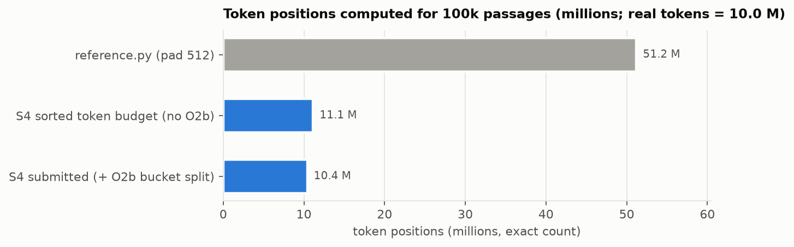 | 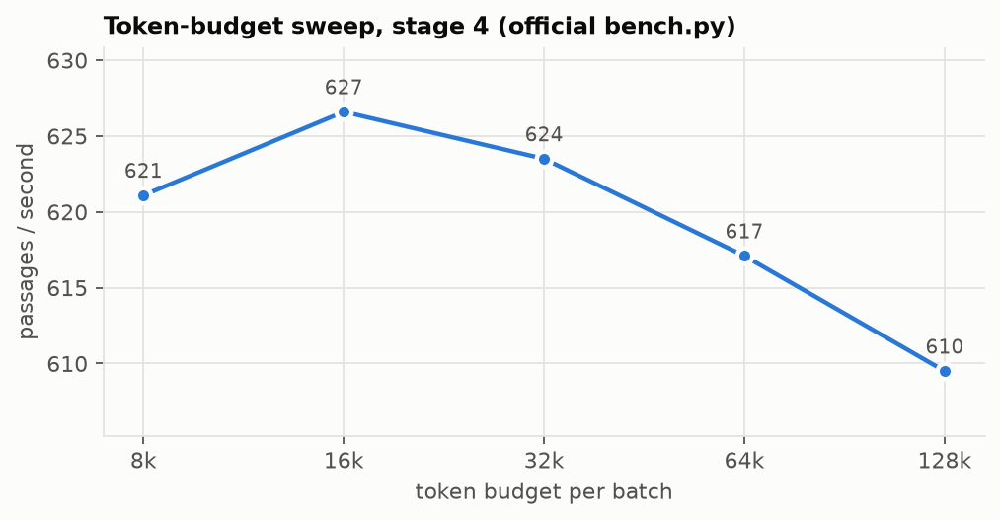 |
| 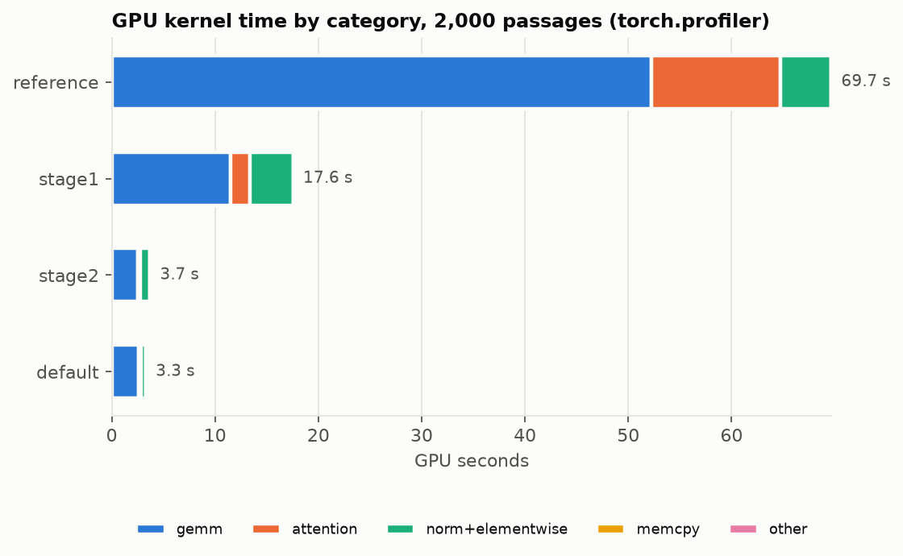 | 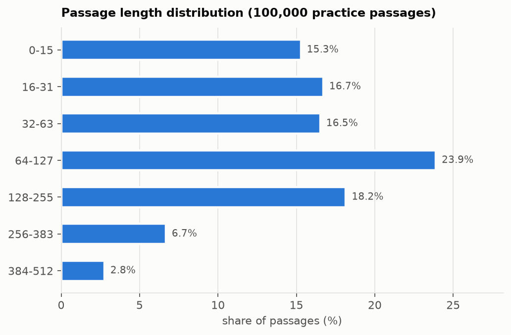 |
| 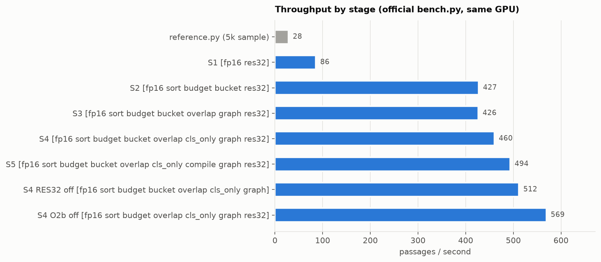 | 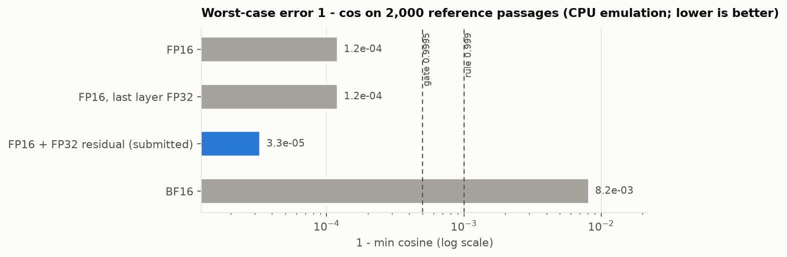 |
</details>

---

## 6. Complete setup guide

### 6.1 Requirements

| | GPU machine (measurements) | Windows laptop (development, CPU checks) |
|---|---|---|
| OS | Linux (Ubuntu / Arch tested), or WSL / Git Bash | Windows 10/11 |
| Python | tested 3.14.10 | tested 3.12.10 |
| GPU | NVIDIA, compute capability ≥ 7.0 for FP16 Tensor Cores (tested: RTX 3050 6 GB) | none needed |
| PyTorch | ≥ 2.1 CUDA build (tested 2.15.0 + cu132) | ≥ 2.1 CPU build (tested 2.15.0 + cpu) |
| Packages | [`requirements-gpu.txt`](Kernel-Optimised-Encoder-main/requirements-gpu.txt) | [`requirements.txt`](Kernel-Optimised-Encoder-main/requirements.txt) · pinned: [`requirements-verified-windows-cpu.txt`](Kernel-Optimised-Encoder-main/requirements-verified-windows-cpu.txt) |
| Network | first run downloads the model weights and the dataset from Hugging Face | same |

**Dataset and official harness.** `data/` is git-ignored. On the first run the workflows download it from the
Hugging Face dataset [`Tarakeshwaran/CIT_Hackathon_PS09_encoder`](https://huggingface.co/datasets/Tarakeshwaran/CIT_Hackathon_PS09_encoder).
It contains `practice_passages.jsonl`, `practice_trace.jsonl`, the reference embeddings (`practice_ref_first2000.npy`, `practice_ref_queries.npy`), `bench.py` and `reference.py`. To fetch it manually:

```bash
python -c "from huggingface_hub import snapshot_download; snapshot_download('Tarakeshwaran/CIT_Hackathon_PS09_encoder', repo_type='dataset', local_dir='data')"
```

### 6.2 Windows laptop (no NVIDIA GPU)

```powershell
cd Kernel-Optimised-Encoder-main
winget install --id Python.Python.3.12 --scope user                  # once, if Python is missing
powershell -ExecutionPolicy Bypass -File .\run_all.ps1               # venv, deps, dataset, edge-case tests, accuracy, workload stats
powershell -ExecutionPolicy Bypass -File .\run_all.ps1 -Precision    # + FP16 precision study (CPU emulation, ~30 min)
powershell -ExecutionPolicy Bypass -File .\run_all.ps1 -DryRunBench  # + official bench.py on 300 passages (CPU FP32)
powershell -ExecutionPolicy Bypass -File .\run_all.ps1 -Report       # rebuild the technical report + PDF from results
```

Results go to `results_cpu/`. If the machine *does* have a CUDA GPU, `run_all.ps1` points you to `run_all.sh` in Git Bash.

### 6.3 Linux machine with an NVIDIA GPU (the measurements)

```bash
cd Kernel-Optimised-Encoder-main
bash run_all.sh                  # quick path: env + baseline, edge-case tests, accuracy, ablation (20k), budget sweep, latency, profiles
bash run_all.sh --full           # + final 100k official bench and the full 100k accuracy check (~30–40 min more)
bash run_all.sh --step sweep     # one step only: env | test | validate | ablation | sweep | latency | profile | full | collect
python scripts/apply_best_config.py --sweep results_gpu/token_budget/ablation.csv --stage 4 --apply   # set defaults from the sweep
```

- **Restartable:** a step is skipped if its result file already exists. Delete the file to redo the step.
- **Logged:** each step's OK/FAIL is written to `results_gpu/STATUS.txt`, and `results_gpu/SUMMARY.md` is regenerated from the result files.
- **Without git:** copy the self-extracting [`install_ps09.sh`](Kernel-Optimised-Encoder-main/install_ps09.sh) to the GPU machine and run `bash install_ps09.sh ~/ps09 --no-run`.
- **Baseline:** the 1-hour FP32 reference over 100k passages is never re-run. `reference.py` pads everything to 512, so its cost per passage doesn't depend on the text, and the 5,000-passage sample is the baseline.

### 6.4 Running pieces by hand

```bash
python validate.py --data data                         # accuracy gate: worst-case cosine vs official refs (gate 0.9995)
python tests/test_correctness.py --stages 1 2 3 4      # 29 edge cases vs reference.py
python demo.py                                         # judge demo: reference vs ours, padding, throughput, latency, search
python profile_run.py --which team --data data --out results_gpu/profiler/default
python run_ablation.py --data data --stages 1 2 3 4 --limit 20000 --out-dir results_gpu/ablation
python scripts/full_check.py run --data data --out results_gpu/final/submitted_100k.npy
python scripts/live_latency.py --data data --mode realtime
python data/bench.py --team team.py --passages data/practice_passages.jsonl \n    --ref data/practice_ref_first2000.npy --trace data/practice_trace.jsonl \n    --ref-queries data/practice_ref_queries.npy --out bench.json   # the official harness
```

### 6.5 Configuration switches

The organisers run `team.py` **with no environment variables**. The submitted defaults are constants at the top of the file:

```python
DEFAULT_STAGE = 4            # fp16, sort, budget, bucket, overlap, cls_only, graph
DEFAULT_TOKEN_BUDGET = 8192  # tokens per batch
DEFAULT_RES32 = 0            # P1 off (superseded by P2)
DEFAULT_SHORT_FP32 = 32      # P2: inputs of <= 32 tokens run in FP32
```

<details>
<summary><b>Environment variables for experiments</b></summary>

| Variable | Effect |
|---|---|
| `PS09_STAGE=0..5` | Cumulative preset (0 behaves like `reference.py`) |
| `PS09_FP16`, `PS09_SORT`, `PS09_BUDGET`, `PS09_BUCKET`, `PS09_OVERLAP`, `PS09_CLS_ONLY`, `PS09_COMPILE`, `PS09_GRAPH` | Toggle one optimisation (`0`/`1`), overriding the stage |
| `PS09_TOKEN_BUDGET`, `PS09_MIN_FILL`, `PS09_CHUNK` | Scheduler tuning |
| `PS09_SHORT_FP32`, `PS09_RES32`, `PS09_BF16`, `PS09_FP16_ACCUM`, `PS09_STRICT_REDUCTION` | Precision experiments |
| `PS09_MODEL` | Model id or a local folder |
| `PS09_DEBUG` | Activation-range logging |

After changing a default, run `python scripts/build_installer.py` to regenerate `install_ps09.sh`.
</details>

---

## 7. Repository map

```
Kernel-Optimised-for-Encoder/
├── README.md                         ← you are here
├── assets/readme/                    animated SVGs for this README (+ _generate.py that builds them)
└── Kernel-Optimised-Encoder-main/
    ├── team.py                       ★ the submission: setup() + encode(texts)
    ├── validate.py                   accuracy gate vs official references
    ├── demo.py                       judge demo
    ├── profile_run.py                torch.profiler evidence (Chrome trace, GPU-time split, idle gaps)
    ├── run_ablation.py               runs official bench.py per stage → ablation.csv / ABLATION.md
    ├── run_all.sh / run_all.ps1      GPU (Linux) / CPU (Windows) workflows
    ├── install_ps09.sh               self-extracting copy of the code (generated)
    ├── tests/                        edge cases vs reference.py, FP16-on-CPU checks
    ├── scripts/                      precision study, workload stats, latency, full 100k check, report builder …
    ├── docs/                         technical report, plans, literature survey, judge Q&A, demo guide
    ├── reports/                      PS09_Final_Report.pdf/.html, explainer, charts/
    ├── showcase/index.html           interactive results page
    ├── results_gpu/                  ★ GPU evidence: hardware, accuracy, ablation, token_budget, latency, profiler, final, repeats
    └── results_cpu/                  CPU evidence (tests, precision study, workload stats, dry-run benches)
```

📄 Read further: [Technical report](Kernel-Optimised-Encoder-main/docs/technical_report.md) ·
[Final report (PDF)](Kernel-Optimised-Encoder-main/reports/PS09_Final_Report.pdf) ·
[Implementation tracker](Kernel-Optimised-Encoder-main/TRACKER.md) ·
[Judge Q&A](Kernel-Optimised-Encoder-main/docs/judge_qa.md) ·
[Demo guide](Kernel-Optimised-Encoder-main/docs/demo_guide.md)

---

## 8. Conclusion

On an RTX 3050 6 GB **laptop** GPU, the submitted `team.py` embeds 100,000 passages at **604.9 passages/s, 21.3× the
reference**. Every one of the 100,000 practice passages stays at **cosine ≥ 0.999992** to FP32, live queries are
answered in **p50 4.4 ms / p99 8.2 ms**, and peak memory is **1.6 GB**.

- **The gains came in the order the analysis predicted.** FP16 Tensor-Core kernels gave 3×. Removing padding gave another 5×, the biggest single lever. The host pipeline and the CLS-only last layer then closed the remaining gaps. The profile went from **75% FP32 GEMM with 136 idle gaps** to Tensor-Core GEMMs with **7 idle gaps** and the GPU busy 99.7% of the time.
- **Precision was the real risk, not speed.** Checking all 100,000 passages instead of the official 2,000 exposed FP16 failures on a few short passages that the official check couldn't see. Routing inputs of ≤ 32 tokens through FP32 removed them for about 3% of throughput.
- **Decisions were measured, not assumed.** Every default came from interleaved repeat runs, and every rejected idea (BF16, `torch.compile`, the FP32 residual stream) has a result file explaining why.

### Limitations

- Laptop GPU timings drift at high VRAM use, so decisions use small-budget interleaved repeats (±1.5%).
- Absolute numbers will differ on the judging GPU. The code adapts: the budget halves automatically, and graphs and compile fall back to eager if they fail.
- The reference baseline is a 5,000-passage sample. This is valid because its cost per passage doesn't depend on the text.
- Official reference embeddings exist only for 2,000 passages. The other 98,000 are checked against our FP32 path, which matches the official references exactly.
- `bench.py` sends one query per call, so the p99 during a burst is roughly burst size × per-query service time.

### Future work

- Triton-fused bias + GELU and bias + residual + LayerNorm kernels, if element-wise work grows as a share of GPU time.
- Padding-free (varlen) attention for workloads with a flatter length distribution.
- Multi-stream execution of small and large batches.

### References

1. Xiao et al., *C-Pack: Packaged Resources To Advance General Chinese Embedding* (BGE), 2023.
2. Devlin et al., *BERT: Pre-training of Deep Bidirectional Transformers*, NAACL 2019.
3. Dao et al., *FlashAttention: Fast and Memory-Efficient Exact Attention with IO-Awareness*, NeurIPS 2022.
4. Micikevicius et al., *Mixed Precision Training*, ICLR 2018.
5. NVIDIA, *CUDA C++ Programming Guide: CUDA Graphs*. PyTorch docs: `torch.cuda.graphs`, `torch.profiler`, `scaled_dot_product_attention`.

<p align="center"><sub>Animations are pure SVG + CSS (GitHub strips JavaScript from READMEs), with easing modelled on <a href="https://animejs.com/">anime.js</a>.
They respect <code>prefers-reduced-motion</code>. Regenerate them with <code>python assets/readme/_generate.py assets/readme</code>.</sub></p>
